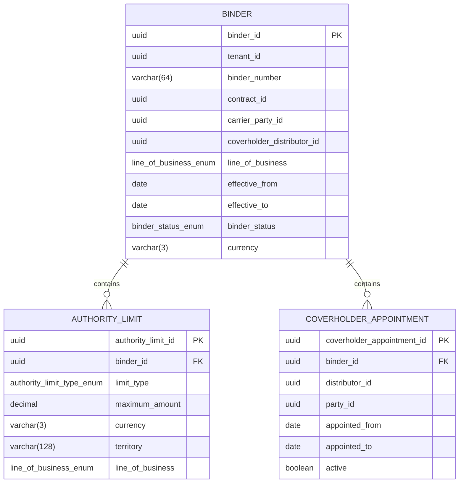

<a href="https://fireflysoftware.io/openplatform/">
<picture>
  <source media="(max-width: 640px) and (prefers-color-scheme: dark)" srcset="https://raw.githubusercontent.com/fireflysoftwaresolutions/.github/main/profile/assets/banner-narrow-dark.svg">
  <source media="(max-width: 640px)" srcset="https://raw.githubusercontent.com/fireflysoftwaresolutions/.github/main/profile/assets/banner-narrow-light.svg">
  <source media="(prefers-color-scheme: dark)" srcset="https://raw.githubusercontent.com/fireflysoftwaresolutions/.github/main/profile/assets/banner-dark.svg">
  
</picture>
</a>

# Firefly OpenPlatform - Core Insurance - Delegated Authority

Developed by the Firefly Software Foundation. [dev@fireflysoftware.io](mailto:dev@fireflysoftware.io)

[Website](https://fireflysoftware.io/) · [OpenPlatform](https://fireflysoftware.io/openplatform/) · [Module catalogue](https://fireflysoftware.io/openplatform/modules/)

Core repository for binders, authority limits, and coverholder appointments.

Repository: [https://github.com/firefly-oss/core-insurance-delegated-authority](https://github.com/firefly-oss/core-insurance-delegated-authority)

Stores the authority an insurer delegates to a coverholder. The binder agreement itself remains a contract. Bordereaux remain in core-insurance-financials. This service does not decide whether a risk is inside authority.

This is a **core** service. It owns its tables and exposes a reactive API. It does not call other core services. Domain orchestration is intentionally not in this repository.

A binder follows an explicit status lifecycle. `DRAFT` may become `ACTIVE`. `ACTIVE` may become `SUSPENDED` or `EXPIRED`. `SUSPENDED` may return to `ACTIVE` or become `EXPIRED`. `EXPIRED` stays on file. Only a `DRAFT` binder can be removed. An active binder stays on file.

## What it does not own

- The binder contract document and parties. contractId points at core-common-contract-mgmt.
- The carrier and coverholder as customers. party and distributor ids point at customer and distributor management.
- Premium bordereaux. Those are core-insurance-financials.
- The underwriting decision that consumes a limit. That is core-insurance-underwriting.

Cross-service identifiers are UUID columns without a database foreign key. A missing party, contract, product, document, distributor, policy, claim, or payment order is not enforced here. The domain layer, when it exists, is responsible for that coordination.

## Module structure

| Module | Purpose |
|--------|---------|
| `core-insurance-delegated-authority-interfaces` | DTOs and enums |
| `core-insurance-delegated-authority-models` | R2DBC entities, repositories, Flyway migrations |
| `core-insurance-delegated-authority-core` | Services and MapStruct mappers |
| `core-insurance-delegated-authority-web` | Spring Boot application and REST controllers |
| `core-insurance-delegated-authority-sdk` | Reactive Java client generated from the OpenAPI document |

## Data model



Fields that point at another Firefly service are logical references. Foreign keys exist only inside this database.

## API

| Method | Path | Purpose |
|--------|------|---------|
| POST | `/api/v1/binders/filter` | Filter binders |
| POST | `/api/v1/binders` | Create a Binder |
| GET | `/api/v1/binders/{binderId}` | Get a Binder |
| PUT | `/api/v1/binders/{binderId}` | Update a Binder |
| DELETE | `/api/v1/binders/{binderId}` | Delete a draft binder. An active binder stays on file |
| POST | `/api/v1/binders/{binderId}/limits/filter` | Filter authoritylimits |
| POST | `/api/v1/binders/{binderId}/limits` | Create a AuthorityLimit |
| GET | `/api/v1/binders/{binderId}/limits/{authorityLimitId}` | Get a AuthorityLimit |
| PUT | `/api/v1/binders/{binderId}/limits/{authorityLimitId}` | Update a AuthorityLimit |
| DELETE | `/api/v1/binders/{binderId}/limits/{authorityLimitId}` | Delete a AuthorityLimit |
| POST | `/api/v1/binders/{binderId}/appointments/filter` | Filter coverholderappointments |
| POST | `/api/v1/binders/{binderId}/appointments` | Create a CoverholderAppointment |
| GET | `/api/v1/binders/{binderId}/appointments/{coverholderAppointmentId}` | Get a CoverholderAppointment |
| PUT | `/api/v1/binders/{binderId}/appointments/{coverholderAppointmentId}` | Update a CoverholderAppointment |
| DELETE | `/api/v1/binders/{binderId}/appointments/{coverholderAppointmentId}` | Delete a CoverholderAppointment |

Missing rows return HTTP 404 through `ResourceNotFoundException`. A child row whose parent id does not match the path also returns 404.

Swagger UI: `/swagger-ui.html`. OpenAPI: `/v3/api-docs`.

## Configuration

| Variable | Description |
|----------|-------------|
| `DB_HOST` | PostgreSQL host |
| `DB_PORT` | PostgreSQL port |
| `DB_NAME` | Database name |
| `DB_USERNAME` | Database user |
| `DB_PASSWORD` | Database password |
| `DB_SSL_MODE` | `disable`, `require`, or another PostgreSQL SSL mode |
| `SERVER_ADDRESS` | Bind address, default `localhost` |
| `SERVER_PORT` | HTTP port, default `8080` |

Create an empty database before the first start. Flyway applies `db/migration` on boot.

## Build and run

```bash
mvn clean verify
mvn -pl core-insurance-delegated-authority-web spring-boot:run
```

Java 25 and Maven 3.9 or newer. The parent POM is `io.fireflysoftware:firefly-parent:26.10.1`.

## Stack

Java 25, Spring Boot WebFlux, virtual threads, Spring Data R2DBC, PostgreSQL, Flyway, MapStruct, SpringDoc, Micrometer Prometheus.

## Actuator

| Endpoint | Purpose |
|----------|---------|
| `/actuator/health` | Liveness and readiness |
| `/actuator/info` | Build information |
| `/actuator/prometheus` | Metrics |

## Publisher

| | |
|--|--|
| Developed by | Firefly Software Foundation |
| Development contact | dev@fireflysoftware.io |
| Platform | https://openplatform.fireflysoftware.io |
| Website | https://fireflysoftware.io |
